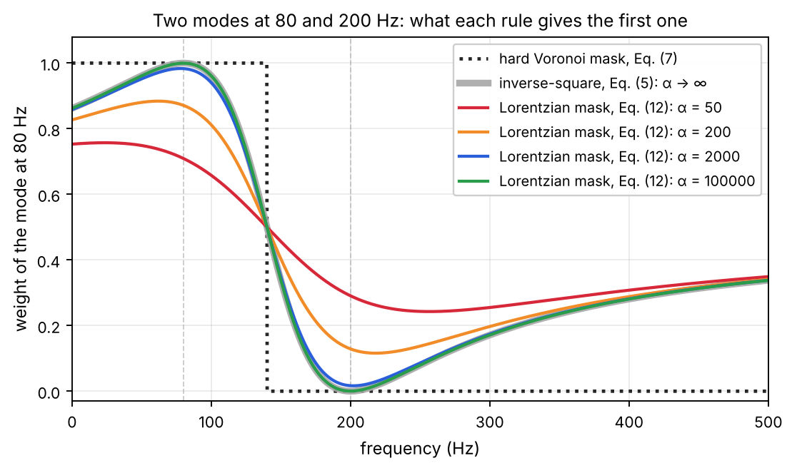
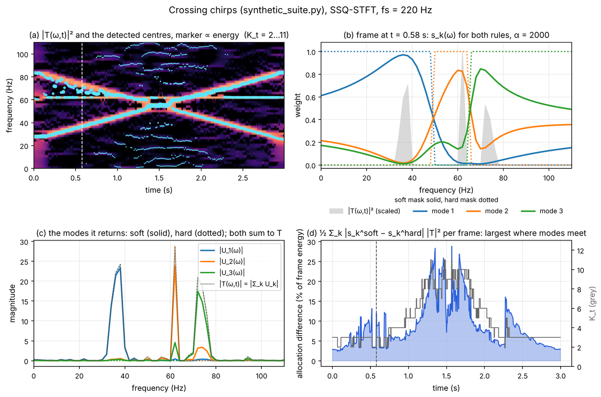
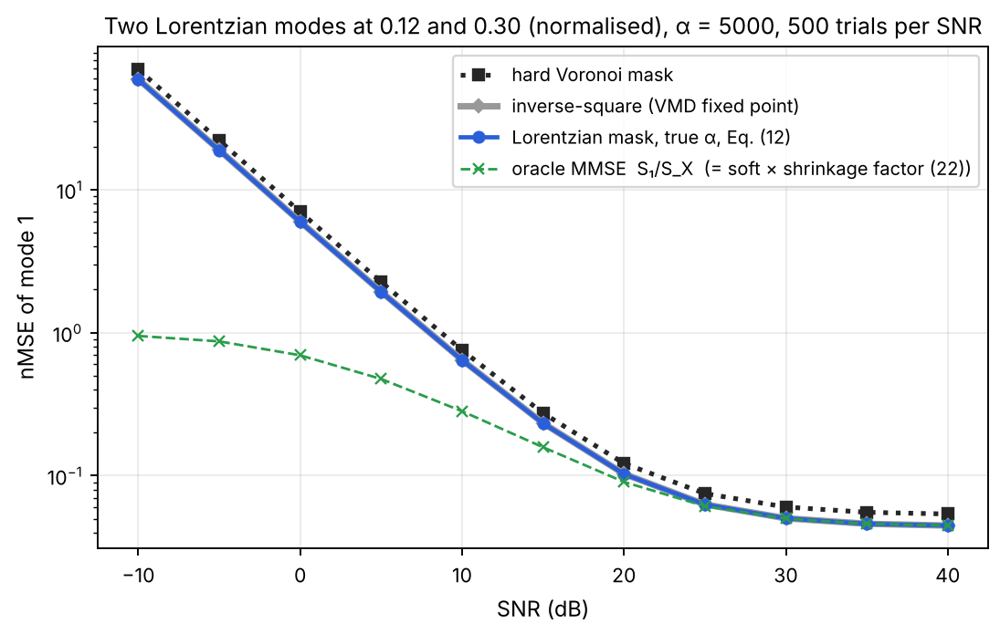
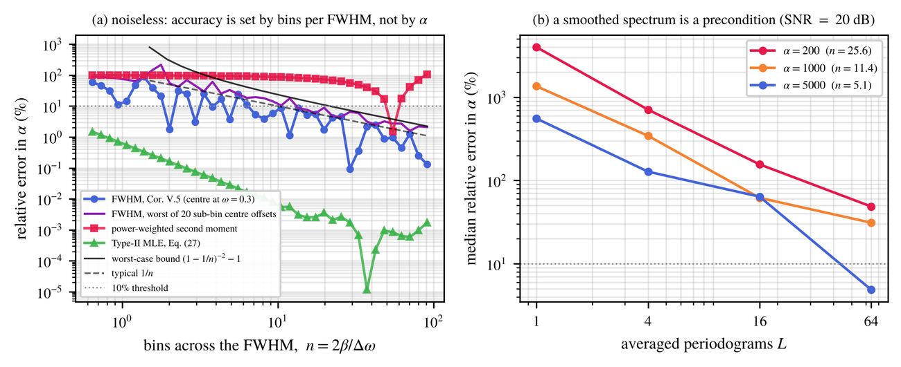
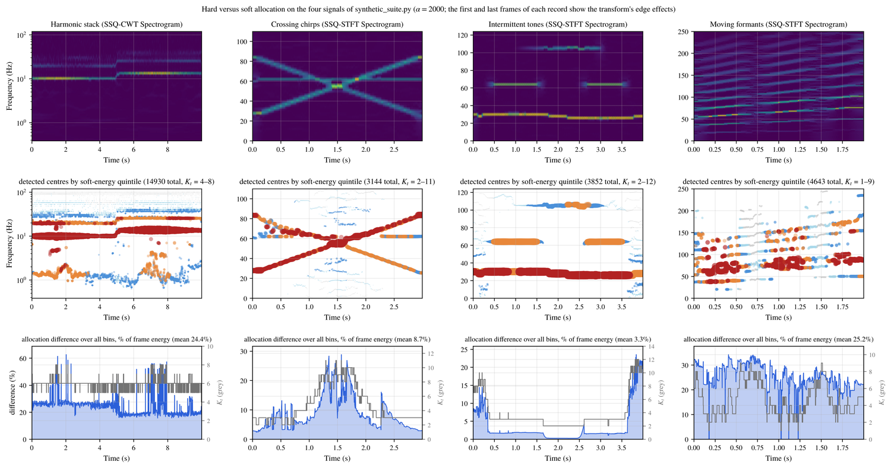

# A Closed-Form Soft Spectral Partition for Adaptive Mode Decomposition

Reference implementation of the paper of the same title (IEEE Transactions on Signal
Processing), as the Python package **`softdamd`**: the method, the experiments, and a
verification suite for the paper's statements.

[](LICENSE)


<!-- Once this repository is on GitHub, replace OWNER/REPO below and move the line
     above this comment:
[](https://github.com/OWNER/REPO/actions/workflows/tests.yml)
-->

Adaptive mode decomposition detects mode centres in the time–frequency plane and then
assigns each coefficient to a mode. DAMD assigns it to the nearest centre — a hard
Voronoi mask. This package implements the soft alternative of the paper: a normalised
Lorentzian mask, in closed form, on the same centres and at the same detection cost.

<p align="center">
  
</p>

<p align="center"><sub>What each rule gives the mode at 80 Hz when a second mode sits at
200 Hz. Dotted: the hard Voronoi mask of DAMD. Coloured: the Lorentzian mask at four
values of α. Grey: its α → ∞ limit, the inverse-square allocation — which is the VMD ADMM
fixed point, not the Voronoi step.</sub></p>

## Contents

- [What you get](#what-you-get)
- [Install](#install)
- [Quick start](#quick-start)
- [How it works](#how-it-works)
- [Accuracy](#accuracy)
- [Choosing α](#choosing-α)
- [Conventions](#conventions)
- [API at a glance](#api-at-a-glance)
- [Tests](#tests)
- [Reproducing the paper](#reproducing-the-paper)
- [Citing](#citing) · [License](#license)

## What you get

- **A closed form.** At fixed centres the mask minimises a regularised soft VMD
  objective, uniquely wherever the spectrum is non-zero (Theorem IV.3): one expression
  per coefficient, no iteration.
- **The VMD fixed point as its limit.** As α → ∞ the family tends to the inverse-square
  allocation, which is what the VMD ADMM iteration converges to once reconstruction is
  enforced — and *not* to the Voronoi mask (Corollary IV.9, Remark IV.10). α controls how
  closely the allocation approaches that point.
- **A Bayesian reading.** Under a Lorentzian spectral prior the mask is the MMSE
  estimator of the mode coefficients in the low-noise limit (Theorem V.2); at finite
  noise the two differ by a known shrinkage factor (Remark V.4).
- **One pass.** O(F·K_t) per frame after detection, which is unchanged; the modes sum
  back to the input exactly, for any invertible transform.

Not claimed: optimality in the waveform domain — the masked coefficient array does not
stay in the range of the analysis operator, so the MMSE statement is a coefficient-domain
one (Remark VII.1); and the runtime comparison against STVMD in the paper is a pipeline
comparison, not an equal-task, equal-accuracy speed-up.

## Install

```bash
python -m venv .venv && source .venv/bin/activate
pip install -e ".[viz]"      # + matplotlib, for the figures
```

Python ≥ 3.10, NumPy ≥ 2.0, SciPy ≥ 1.9, Numba ≥ 0.60. Numba is required, not optional:
the mean-shift loop is compiled with it and there is no fallback path, so results do not
depend on what else is installed. The first call compiles the loop (a few seconds) and
caches it on disk.

## Quick start

```python
import numpy as np
import softdamd as sd

fs = 1000.0
n  = np.arange(2048) / fs
x  = np.cos(2 * np.pi * 80 * n) + 0.8 * np.cos(2 * np.pi * 200 * n)   # two modes

res = sd.SoftDAMD(sd.STFT(n_fft=256, hop=1),                     # 𝒯
                  sd.MeanShift(bandwidth='unit', adapt='none'),  # Step 1: detection
                  alpha=2000.0).run(x, fs=fs)                    # Step 2: Eq. (12)

t = 10                        # any frame index
res.partition.centers_at(t)   # centres of frame t, normalised frequency
res.weights(t)                # s*_k(ω) of frame t, (K_t, F)
res.modes(t, mode='hard')     # U_k(ω, t) with the Voronoi mask, Eq. (7)
res.energy(t)                 # Σ_ω s_k(ω)|𝒯(ω,t)|², (K_t,)
res.reconstruct()             # inverse transform of Σ_k U_k
```

Detection and extraction are independent, so oracle or deliberately perturbed centres
can be substituted, and α can be a number, one value per mode, or `'fwhm'` for the
per-mode estimate of Corollary V.5:

```python
P = sd.Partition.from_centers(centres_per_frame, res.tfmap.freqs)
U = sd.extract(res.tfmap, P, t, mode='soft', alpha=2000.0)
W = res.weights(t, alpha='fwhm')
```

Signals are single-channel, shape `(N,)`; coefficients are `(F, T)`. Transforms:
`STFT`, `SSQSTFT`, `CWT`, `SSQCWT`.

## How it works

**Step 1 — detection** (unchanged from DAMD). In every frame $t$ a mean-shift pass over
$|\mathcal{T}(\omega,t)|^2$ returns $K_t$ centres $\omega_{k,t}$. Nothing about the
soft mask touches this step, so whatever detector settings a pipeline already uses stay
as they are.

**Step 2 — allocation.** Each coefficient is split among the $K_t$ modes by weights that
sum to one, $U_k(\omega,t)=s_k(\omega)\,\mathcal{T}(\omega,t)$. DAMD uses the Voronoi
indicator; this package uses the normalised Lorentzian mask

$$
s_k^*(\omega)=\frac{\bigl[1+2\alpha(\omega-\omega_k)^2\bigr]^{-1}}
                   {\sum_{j}\bigl[1+2\alpha(\omega-\omega_j)^2\bigr]^{-1}},
\qquad\text{Eq. (12)},
$$

which is the minimiser, over the simplex and for each $\omega$ separately, of the
VMD bandwidth cost plus the regulariser $\tfrac{1}{2\alpha}\sum_k s_k^2$, unique wherever
the spectrum is non-zero. Two limits
place it: as $\alpha\to\infty$ it becomes the inverse-square allocation
$d_k^{-2}/\sum_j d_j^{-2}$ with $d_k=|\omega-\omega_k|$ — the VMD ADMM fixed point,
Eq. (5) — and as $\alpha\to 0$ it becomes uniform, $1/K$. The Voronoi mask is not in
the family at any α.

**Why Lorentzian.** If each mode has a Lorentzian spectral density of half-width
$\beta_k=1/\sqrt{2\alpha_k}$, the MMSE estimator of the mode coefficient is the Wiener
weight $S_k/S_X$, and in the low-noise limit that weight is exactly the mask above with
per-mode $\alpha_k$ (Theorem V.2 via Corollary IV.7). At finite noise the Wiener weight is
the mask times a shrinkage factor $\sum_j S_j/(\sum_j S_j+\sigma_N^2)$, which the mask
cannot reproduce because its weights sum to one — see the accuracy curves below.

**What transfers to the waveform.** Reconstruction does: $\sum_k u_k=x$ holds for every
invertible transform because the weights sum to one and synthesis is linear, up to the
transform's own round-trip error (about $6\times10^{-16}$ for the unit-hop STFT; larger
for the synchrosqueezed and wavelet transforms, whose inverses are approximate). Per-bin
MMSE optimality does not transfer, and is not claimed.

<p align="center">
  
</p>

<p align="center"><sub>The pipeline on the crossing-chirps signal of
<code>synthetic_suite.py</code> (SSQ-STFT, α = 2000). (a) Detected centres, marker size
∝ energy. (b) One frame with three modes: the soft weights and the hard steps.
(c) The extracted mode spectra under each rule; both sets sum to the input. (d) How much
the two allocations differ, frame by frame — the quantity reported in Table IV of the
paper — against the detected mode count: it is largest where the modes meet.</sub></p>

## Accuracy

<p align="center">
  
</p>

<p align="center"><sub>Two Lorentzian modes at normalised frequencies 0.12 and 0.30,
α = 5000, 500 Monte Carlo trials per SNR (Experiment C of the paper uses 2000). The
inverse-square curve lies under the Lorentzian one. The oracle is the Wiener weight
$S_1/S_X$, which the mask times the shrinkage factor (22) reproduces identically.</sub></p>

Under the model the mask is the MMSE estimator in the low-noise limit and the hard mask
stays above it at every SNR; at 40 dB the nMSE is 0.045 against 0.054 for hard
extraction, the common floor being the irreducible error of separating two overlapping
Lorentzians. The fixed-centre inverse-square allocation — the VMD fixed point — is within
0.5% of the mask at every SNR here; finite α buys 0.8%, 2.0% and 3.7% at 40 dB once the
two modes are 3, 2 and 1.5 FWHM apart, so regularisation pays mainly for close modes. At
low SNR the mask cannot attenuate noise, because $\sum_k s_k=1$; the shrinkage factor of
Remark V.4 closes that gap by construction.

For spectral shapes that are not Lorentzian (Gaussian, raised-cosine, rectangular) the
mask still beats hard extraction at exact centres, though it is no longer close to the
oracle; at high SNR
with inward centre errors of about one FWHM or more (two for Lorentzian modes), or for line
components far narrower than the prior, hard extraction wins. These cases are measured in Experiments C′ and S4 of the paper and are
reproduced by `exp_robustness.py` and `exp_recovery.py`.

## Choosing α

α is a bandwidth: in normalised frequency the half-width of the prior is
$\beta=1/\sqrt{2\alpha}$, so `α = 2000` means β ≈ 0.016, i.e. 15.8 Hz at fs = 1000 and
3.95 Hz at fs = 250 — one α across several sampling rates is several physical
bandwidths. Three ways to set it:

1. **A known class value.** The paper's default is 2000, which Section II-A converts
   to hertz as above; Experiment D and the synthetic suite here use it.
2. **The FWHM of each detected band** (Corollary V.5): `alpha='fwhm'` gives
   $\hat\alpha_k=2/\mathrm{FWHM}_k^2$ per mode from the spectrum itself. Its accuracy is
   governed by the number of bins across the FWHM, $n=2\beta/\Delta\omega$, not by α:
   within 10% once $n\geq 22$ without noise. On a single noisy periodogram at
   20 dB it is unusable, and averaging periodograms is necessary but not sufficient
   there (Experiment S2 of the paper).
3. **Type-II maximum likelihood** (Eq. (27)) when the mode power and noise floor are
   known; the most accurate, and the most expensive.

<p align="center">
  
</p>

<p align="center"><sub>Experiment S2 of the paper (<code>exp_e.py</code>). Left: error of
three estimators against bins across the FWHM, noiseless. Right: the FWHM estimator at
20 dB SNR against the number of averaged periodograms.</sub></p>

## Conventions

These decide whether your α means what the paper's α means.

| item | convention |
|---|---|
| frequency | normalised `w = f/fs ∈ [0, 0.5]`, Nyquist at 0.5 |
| paper α | denominator `1 + 2·α·(w − w_k)²` |
| implementation α | `softdamd/baselines/vmd.py` uses `1 + α_impl·(w − w_k)²`, so **α_impl = 2·α_paper** |
| β | half-bandwidth `β = 1/√(2α)`, in normalised frequency |
| Voronoi ties | bins equidistant from `m` centres are shared, `s_k = 1/m` (Eq. 7) |

The same table is fixed in code in [`softdamd/units.py`](softdamd/units.py).

## API at a glance

| name | what it is |
|---|---|
| `SoftDAMD(transform, detector, alpha).run(x, fs)` | Algorithm 1; returns a `Decomposition` |
| `Decomposition.weights(t)`, `.modes(t)`, `.energy(t)`, `.reconstruct()` | $s_k(\omega)$, $U_k(\omega,t)$, $E_k$ and $\sum_k u_k$; each takes `mode` (`'soft'` or `'hard'`) and `alpha` |
| `STFT`, `SSQSTFT`, `CWT`, `SSQCWT`, `make_transform(name)` | the transforms 𝒯; coefficients come back as a `TFMap` |
| `MeanShift(bandwidth, adapt, seed_spacing, …)` | Step 1, the DAMD detector |
| `Partition`, `Partition.from_centers(centres, freqs)` | detected or supplied centres per frame |
| `lorentzian_weights(freqs, centres, alpha)` | Eq. (12) on a frequency grid, `(K, F)` |
| `voronoi_weights(freqs, centres)` | Eq. (7), ties shared, `(K, F)` |
| `fwhm_alpha(power, freqs, band)` | $\hat\alpha_k$ of Corollary V.5 |
| `frame_weights`, `extract`, `mode_energy`, `reconstruct` | the functional forms behind the `Decomposition` methods |

## Tests

```bash
pytest tests -q
```

41 property tests, run in seconds, and the same suite runs on every push through GitHub
Actions ([`.github/workflows/tests.yml`](.github/workflows/tests.yml), Python 3.10 and
3.12). They check the definitions rather than agreement with earlier code: perfect
reconstruction and the DFT grid of the STFT, phase referenced to the frame centre,
reconstruction by the synchrosqueezed and wavelet transforms, Σ_k s_k = 1, the α → ∞
limit, the tie rule, the FWHM estimate, and multichannel rejection. If `ssqueezepy` is
installed, `|S|` and the SSQ-STFT magnitude are compared with it.
`tests/golden/baselines.npz` pins the VMD/STVMD outputs.

## Reproducing the paper

Everything here is self-contained: every signal is generated by the scripts themselves
or by [`synthetic_suite.py`](experiments/soft_partition_paper/synthetic_suite.py), and
nothing has to be downloaded. Each script puts the repository root on `sys.path` itself,
so no `PYTHONPATH` is needed and the working directory does not matter.

```bash
python experiments/soft_partition_paper/run_all.py --save_dir figs --only a b c d e f h
python experiments/soft_partition_paper/repro/run_all.py
python docs/make_readme_figures.py          # the images on this page
```

| figure | script | paper |
|---|---|---|
| `fig_vmd_agreement` | `exp_a.py` | Experiment A — Fig. 1 |
| `fig_lorentzian_limits` | `exp_c.py` | Experiment B — Fig. 2 |
| `fig_mmse_shrinkage` | `exp_d.py` | Experiment C — Fig. 3 |
| `fig_robustness` | `exp_robustness.py`, `exp_separation_sweep.py`, `plot_robustness_3panel.py` | Experiment C′ — Fig. 4 |
| `fig_synthetic_suite` | `exp_d_synthetic.py` | — (see below) |
| `figS_wiener_identity` | `exp_b.py` | Experiment S1 — Fig. S1 |
| `fig_alpha_estimation` | `exp_e.py` | Experiment S2 — Fig. S2 |
| `fig_closed_form` | `exp_h.py` | Experiment S3 — Fig. S3 |
| `fig_runtime` | `exp_g.py` | Experiment S5 — Fig. S4 |

The letters in the script names are file identifiers and do not follow the experiment
labels; [`experiments/README.md`](experiments/README.md) carries the full mapping with
seeds, including Experiment S4 (`exp_recovery.py`) and the Appendix I ablation.

Experiment D of the paper — Fig. 5 and Table IV — is measured on four third-party
recordings that are not included, so it is not reproduced here. `exp_d_synthetic.py` runs the
same pipeline and the same boundary measurement on four synthetic signals instead,
chosen to exercise different parts of the detector and of the partition. Their
construction and seeds are in `synthetic_suite.py`; `repro/s11_boundary_energy.py`
reports the boundary exposure and the allocation difference for each. Detection uses
the paper's Experiment D settings throughout — SSQ-STFT or SSQ-CWT with `n_fft = fs/2`
at unit hop, mean shift with the percentile bandwidth rule and curvature adaptation,
α = 2000 — with no per-signal tuning.

<p align="center">
  
</p>

<p align="center"><sub>Top: spectrogram. Middle: the detected centres, coloured by the
quintile of the energy the soft mask gives them. Bottom: how much the two allocations
differ in each frame, over all bins, with the detected mode count in grey. The
difference is large where modes are close or dense (harmonic stack, moving formants, the
chirp crossing) and near zero where they are far apart (intermittent tones); the spikes
at the first and last frames are the transform's edge effects.</sub></p>

| signal (r = 1 bin) | transform | K_t | boundary | allocation difference |
|---|---|---|---|---|
| Harmonic stack — fundamental steps 10 → 13 Hz, three AM harmonics | SSQ-CWT | 4–8 | 5.55% | 2.76% |
| Crossing chirps — 25 ↔ 85 Hz, stationary tone at 62 Hz | SSQ-STFT | 2–11 | 2.61% | 0.71% |
| Intermittent tones — three components switching on and off, one with a slow wobble | SSQ-STFT | 2–12 | 0.10% | 0.05% |
| Moving formants — gliding pulse train under three moving resonances, two silences | SSQ-STFT | 1–9 | 5.07% | 2.45% |

<details>
<summary><b>Timing, figure naming, and the long runs</b></summary>

Experiment `g` runs STVMD at hop = 1 and is by far the slowest, so it caches its
measurements in `<save_dir>/runtime_timings.json`:

```bash
python experiments/soft_partition_paper/exp_g.py --save_dir figs --reps 9     # full run
python experiments/soft_partition_paper/exp_g.py --save_dir figs --reuse      # fill gaps
python experiments/soft_partition_paper/exp_g.py --save_dir figs --plot-only  # redraw only
```

Each figure is written as a vector PDF for the LaTeX build and a PNG for viewing, under
one stable name declared in `figures.py`:

```bash
python experiments/soft_partition_paper/figures.py --latex      # includegraphics lines
python experiments/soft_partition_paper/figures.py --check figs
```

On Windows the same commands work with backslashes in the paths.

</details>

<details>
<summary><b>Verification suite</b></summary>

`repro/` checks the numbered statements of the paper one by one. Closed forms are
compared with an independent simplex solver, the agreement with VMD against the actual
ADMM output, and the transform claims against the shipped implementation — never against
a second copy of the formula under test. The frequency and α conventions are restated
independently in `repro/_common.py`, so a disagreement between the two would show up.

[`experiments/soft_partition_paper/repro/README.md`](experiments/soft_partition_paper/repro/README.md)
describes each script and records what it measured.

</details>

<details>
<summary><b>Repository layout</b></summary>

```
softdamd/                     the method (single channel, NumPy + Numba)
  tf/                         𝒯: STFT, SSQ-STFT, CWT, SSQ-CWT
  detect/                     Step 1 of Algorithm 1: mean-shift detection (DAMD)
  extract.py                  Step 2: hard Voronoi / Lorentzian soft masks, FWHM α̂
  pipeline.py                 SoftDAMD(transform, detector, alpha).run(x, fs)
  baselines/                  VMD, STVMD
  units.py                    frequency and α conventions
tests/                        property tests of every stage; VMD/STVMD reference data
experiments/
  common/                     pipeline runner and plotting helpers
  soft_partition_paper/       the figures and tables of the paper
    figures.py                figure registry: one stable name per figure
    synthetic_suite.py        the four synthetic signals used by the demos
    repro/                    claim-by-claim verification suite
docs/                         the images on this page, and the script that makes them
```

</details>

## Citing

```bibtex
@article{jia_soft_spectral_partition,
  author  = {Jia, Hao and Yang, Chunyu and Feng, Fan and Caiafa, Cesar F. and
             Duan, Feng and Sol{\'e}-Casals, Jordi},
  title   = {A Closed-Form Soft Spectral Partition for Adaptive Mode Decomposition},
  journal = {IEEE Transactions on Signal Processing},
  year    = {2026},
  note    = {Under review}
}
```

Replace `note` with the volume, number, pages and DOI once the paper appears.

## License

MIT — see [LICENSE](LICENSE).
